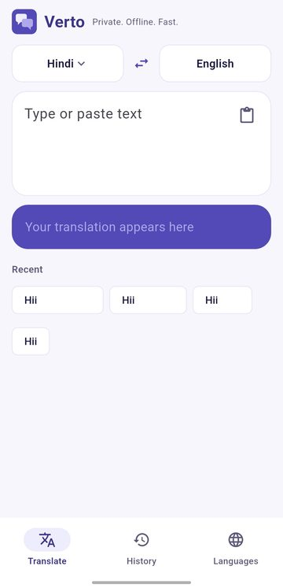
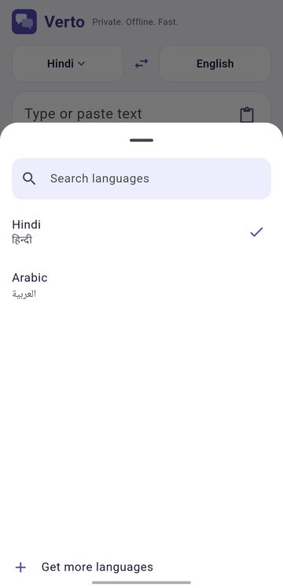
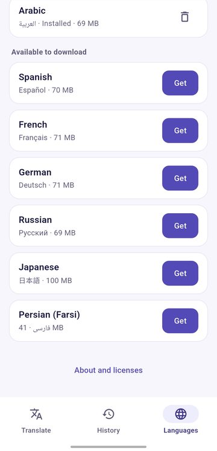
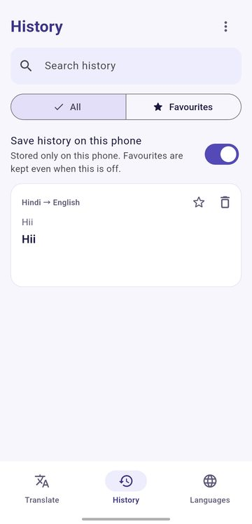

<div align="center">


# Verto

**Private. Offline. Fast.**
A translator for Android that never sends your text anywhere.

[](https://github.com/lumio-apps/verto/releases/latest)
[](https://github.com/lumio-apps/verto/actions/workflows/ci.yml)


[**Download the latest APK**](https://github.com/lumio-apps/verto/releases/latest)

</div>

<table>
  <tr>
    <td align="center"><br><sub>Translate</sub></td>
    <td align="center"><br><sub>Pick a language</sub></td>
    <td align="center"><br><sub>Download languages</sub></td>
    <td align="center"><br><sub>History and favourites</sub></td>
  </tr>
</table>

## Why Verto

- **Nothing leaves your phone.** Translation runs on the device. No account, no ads, no analytics.
- **Small app, big choice.** English is built in. You download only the languages you want, once, and they work in both directions.
- **Yours to keep.** Updating the app or a language never deletes your history, favourites or settings.
- **Open source.** Code and data stay under your control.

## Features

| | |
| --- | --- |
| **Offline translation** | To and from English, with a live preview while you type. |
| **Language packs** | Download inside the app. Sizes shown, resume after a break, SHA-256 check, update or remove one by one. |
| **Search everywhere** | Searchable language lists, so a long list still fits a small screen. |
| **History and favourites** | Stored only on the phone. History can be turned off, favourites stay. |
| **Read aloud** | Uses the voices already on your phone. |
| **Big text** | Show a translation to someone across the table. |
| **Hinglish** | Hindi translations can also be shown in Roman letters. |
| **Clipboard offer** | Optionally offers to translate what you just copied (checked only when Verto opens). |
| **Storage screen** | See what packs and downloads use and clear them. |
| **Dark theme** | Follows the system setting. |
| **In-app update** | Checks GitHub Releases and installs the new APK. |

## Languages

One pack gives both directions: English to X and X to English. Going straight from X to Y, without English, is not offered.

Verto offers every language that [Mozilla's Firefox Translations](https://github.com/mozilla/firefox-translations-models) publishes with both directions to English, for example Hindi, Spanish, French, German, Russian, Japanese, Arabic and Persian. The pack builder finds them by itself. The exact list is in `manifest.json` on the `packs` release.

Armenian is not available yet, see the [roadmap](ROADMAP.md).

## Word safety net

Neural translators can silently skip a word. Verto reduces this and tells you when it may have happened:

1. Text is translated sentence by sentence, long sentences clause by clause.
2. Afterwards every meaningful word is translated on its own and looked for in the result.
3. Words that seem to be missing are highlighted. Tap one to see its translation and add it.

This is a best-effort check, not a guarantee.

## How it works

- **Engine:** [Bergamot translator](https://github.com/browsermt/bergamot-translator) (the engine behind Firefox Translations) as WebAssembly. It runs in a hidden WebView, fed by a tiny web server that listens only on `127.0.0.1` inside the app.
- **Models:** Mozilla's Firefox Translations models (MPL-2.0). They are too large for the APK and are not stored in git. The **Build language packs** workflow copies them to a GitHub release called `packs`, and the app downloads from there.
- **Updates:** the *Languages* tab shows pack updates and an app update check (GitHub Releases).

## Build and release

1. Keep `pubspec.yaml` `version:` in sync with the tag you push (tag `v1.1.1` needs `version: 1.1.1+4`).
2. Push the tag. `.github/workflows/release.yml` fetches the engine, runs analyze and tests, builds the APK, signs it and creates the release.

Repository secrets used by the release workflow:

| Secret | Meaning |
| --- | --- |
| `KEYSTORE_BASE64` | the release keystore file, base64 encoded |
| `KEYSTORE_PASSWORD` | keystore password |
| `KEY_ALIAS` | key alias |
| `KEY_PASSWORD` | key password |

**Language packs:** Actions, then **Build language packs**, then Run workflow. Run it before the first release so the app has something to download. Run it again later to pick up new or improved models; pack versions are bumped automatically.

**CI:** `.github/workflows/ci.yml` runs analyze and tests on every push to `main` and on pull requests.

**Before pushing:**

```
flutter gen-l10n     # only if texts changed
flutter analyze
flutter test
```

**Local development:** `dart run tool/fetch_engine.dart` downloads the engine into `assets/engine/`. `node tool/test_safety.mjs` tests the word safety net.

## Project layout

| Folder | Contents |
| --- | --- |
| `lib/core` | engine bridge, local server, packs, downloads, updates, history |
| `lib/ui` | screens |
| `assets/web` | page and scripts that run in the WebView (`bridge.js`, `safety.js`, `translit.js`) |
| `tool/` | engine fetcher, pack builder, JS tests |
| `.github/workflows` | release, language packs, CI |
| `docs/` | logo and screenshots |

## Roadmap

See [ROADMAP.md](ROADMAP.md). Next up: "Translate with Verto" from any app, language detection, app lock, backup and restore.

## Licenses

Bergamot translator and the Mozilla models are MPL-2.0. See *Languages, About and licenses* in the app. Add your own `LICENSE` file for Verto's code.
